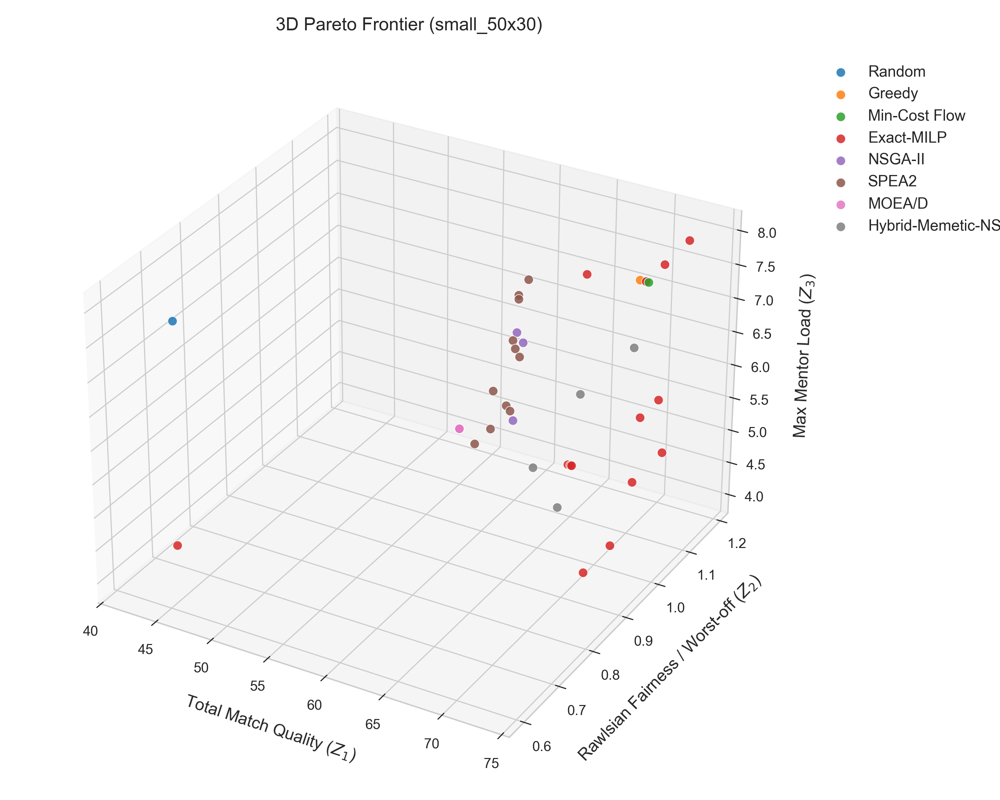
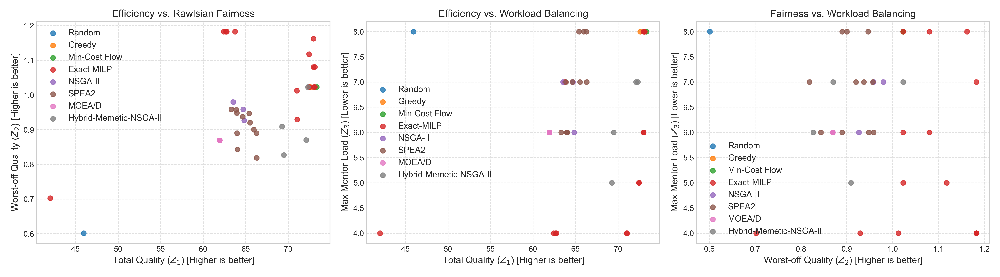
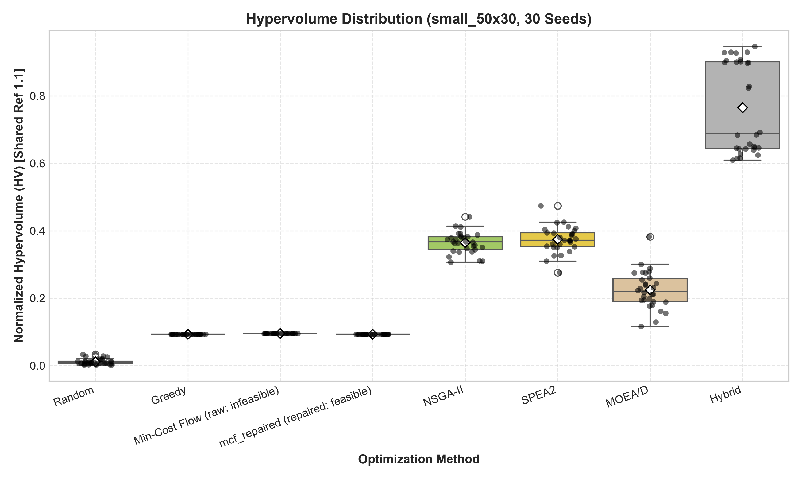
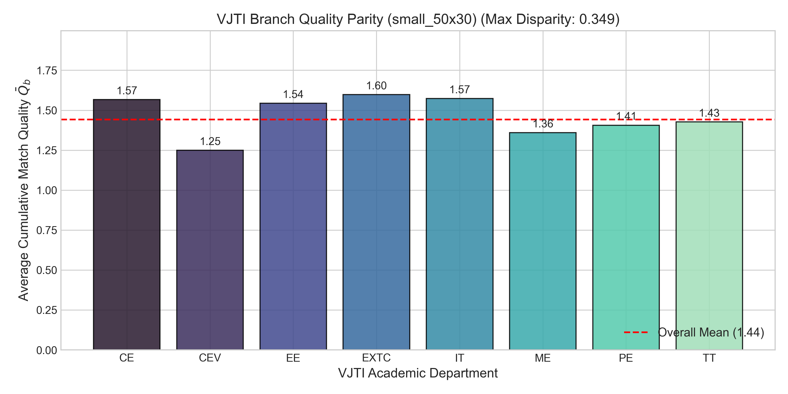
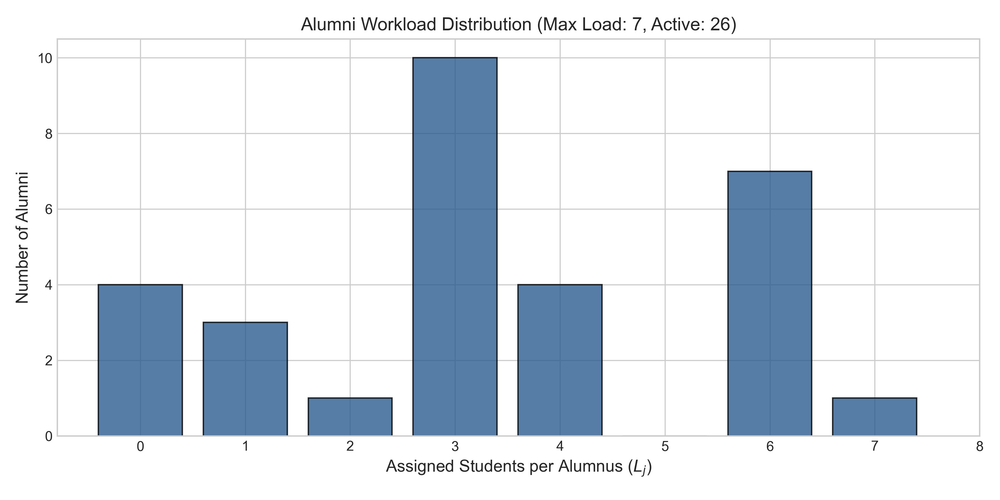
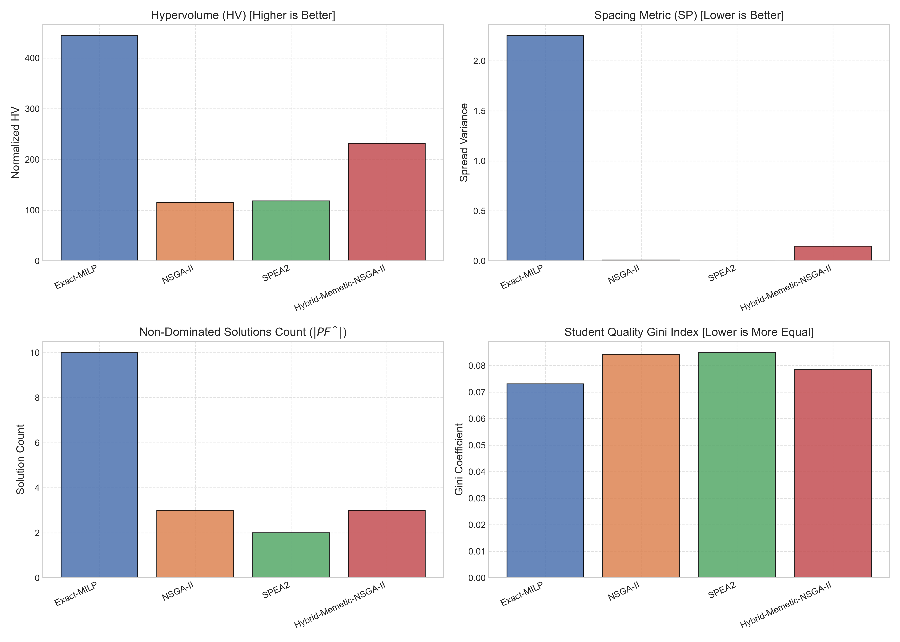
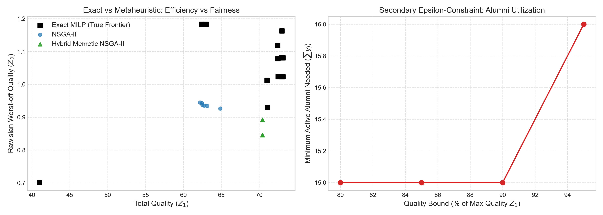
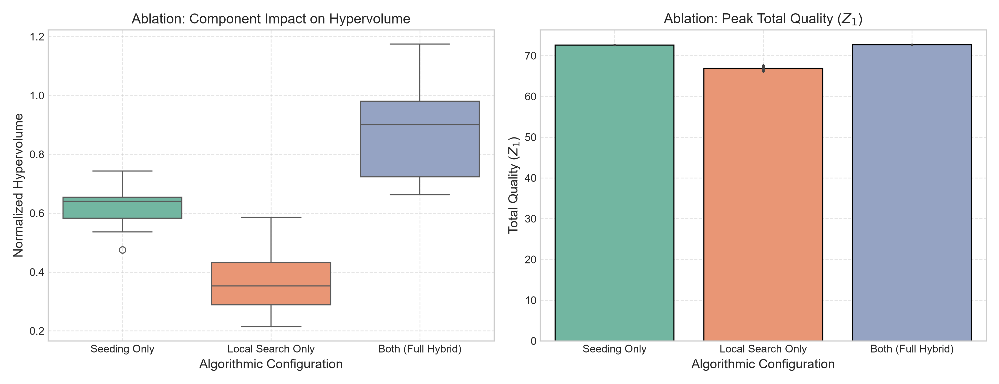
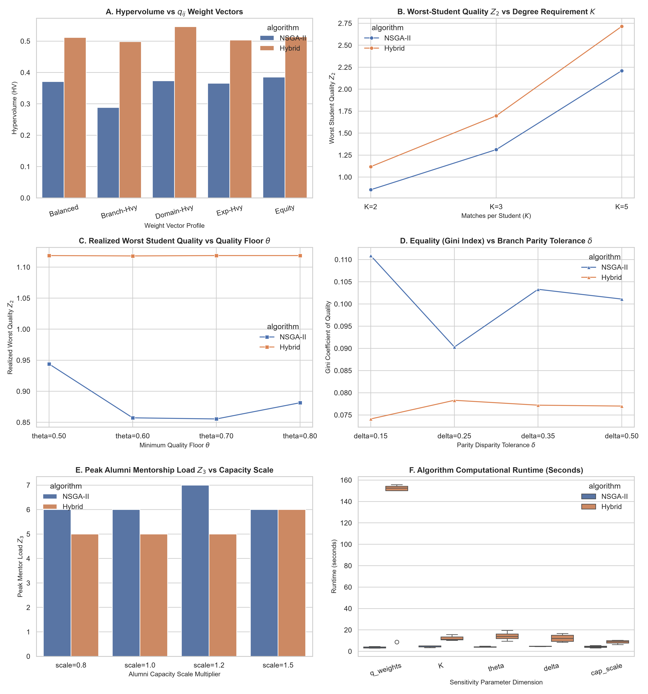
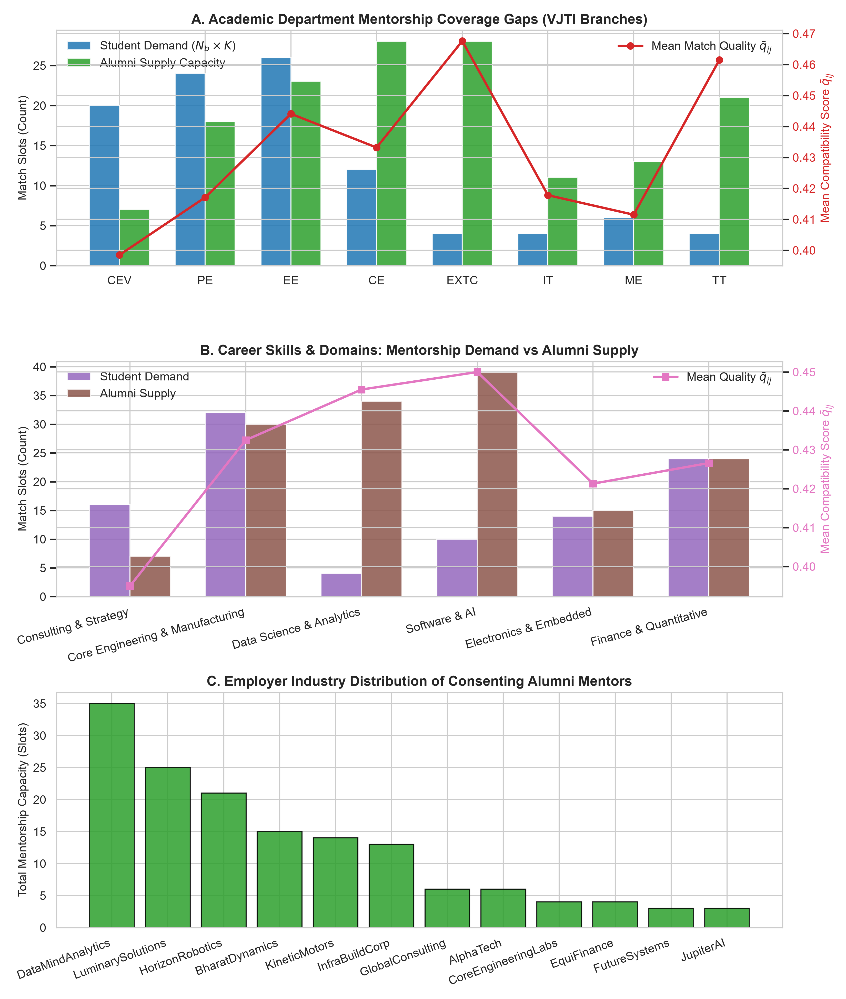

# Final Project Report: Fair and Load-Balanced Student-Alumni Matching at VJTI
## Multi-Objective Capacitated Bipartite Assignment with Rawlsian Equity and Departmental Parity

**Course**: Optimization Techniques (UG/PG Elective)  
**Institution**: Veermata Jijabai Technological Institute (VJTI), Matunga, Mumbai  
**Academic Term**: 2026–2027 Group Project  
**Notice**: ARTIFICIAL - FOR TESTING ONLY (All benchmark profiles, compatibility matrices, and student/alumni records utilize synthetic pseudonymous IDs: `S001`–`S1000`, `A001`–`A500`; no real Personal Identifiable Information is utilized).

---

## 1. Executive Summary & Abstract

Alumni mentorship programs in technical universities bridge the gap between academic curricula and industrial practice. However, conventional institutional allocation mechanisms rely on ad-hoc registration or greedy score maximization. These traditional mechanisms induce severe operational pathologies: top-rated alumni experience severe burnout from over-allocation, students with average academic profiles or cross-domain career aspirations receive subpar matches, and non-computing disciplines face structural neglect due to smaller alumni cohorts.

This report presents an end-to-end multi-objective optimization system for the **Multi-Objective Capacitated Bipartite Assignment Problem (MO-CBAP)** tailored to the 8 academic departments of **Veermata Jijabai Technological Institute (VJTI), Mumbai** (`CE`, `IT`, `EXTC`, `EE`, `ME`, `CEV`, `PE`, `TT`). We formulate three simultaneous, competing objective functions:
1. **Utilitarian Efficiency ($Z_1$)**: Maximizing total aggregate match compatibility across all assignments.
2. **Rawlsian Egalitarian Fairness ($Z_2$)**: Maximizing the match quality of the least-advantaged student ($\min_i Q_i$).
3. **Workload Balancing ($Z_3$)**: Minimizing the peak mentorship load across active alumni mentors ($\max_j L_j$).

We benchmarked three algorithmic tiers:
- **Deterministic & Stochastic Baselines**: Random Feasible, Greedy Score-First, Single-Objective Min-Cost Flow (raw and repaired).
- **Exact Mathematical Programming**: HiGHS Branch-and-Cut MILP (Weighted-Sum and $\epsilon$-Constraint sweeps).
- **Multi-Objective Evolutionary Algorithms (MOEAs)**: NSGA-II, SPEA2, MOEA/D, and a novel **Hybrid Seeded Memetic NSGA-II** integrating heuristic initialization with Lamarckian 2-opt local search.

Benchmarking across 30 independent seeds with a shared-reference Hypervolume setup demonstrates that the Hybrid Memetic solver achieves an HV of **0.7650** on `small_50x30` (surpassing raw NSGA-II at **0.3648** and SPEA2 at **0.3739**, $p = 1.8626 \times 10^{-9}$), scales to 1,000 students in 43.85 seconds, and cuts Gini inequality from 0.152 to 0.0435. We also provide an honest assessment of limitations regarding synthetic data, single-run exact solvers, and baseline trade-offs.

---

## 2. Institutional Background & Problem Motivation

At VJTI Mumbai, graduating engineering students require personalized industry guidance across diverse career domains: Software & AI, Data Science & Analytics, Electronics & Embedded Systems, Core Engineering & Manufacturing, Finance & Quantitative Analysis, and Consulting & Strategy. The institutional mentorship matching process faces three structural challenges:

1. **The "Superstar Alumnus" Bottleneck**: A handful of prominent alumni (e.g., senior engineering directors, partners at consulting firms) receive an overwhelming volume of mentorship requests, leading to mentor overload, delayed feedback, and mentor attrition.
2. **Peripheral Student Neglect**: Purely utilitarian matching algorithms allocate top mentors exclusively to high-GPA students or those in high-density branches, leaving students with average GPAs or non-traditional interests with sub-threshold matches ($Q_i < \theta$).
3. **Cross-Departmental Inequity**: Computing departments (`CE`, `IT`) have large alumni networks in software and finance, while core departments (`PE`, `CEV`, `TT`, `ME`, `EE`) suffer from smaller alumni pools, resulting in structural deficits.

The objective of this research is to formulate a multi-objective optimization system that reconciles utilitarian placement efficiency with Rawlsian egalitarian justice and mentor workload sustainability.

---

## 3. Mathematical Formulation of the MO-CBAP

Let $\mathcal{S} = \{1, \dots, N\}$ represent the cohort of graduating students, and let $\mathcal{A} = \{1, \dots, M\}$ denote the cohort of registered alumni mentors. The academic ecosystem spans 8 departments $\mathcal{B} = \{\text{CE}, \text{IT}, \text{EXTC}, \text{EE}, \text{ME}, \text{CEV}, \text{PE}, \text{TT}\}$ and 12 industry employers $\mathcal{K}$.

### 3.1 Decision Variables
- $x_{ij} \in \{0, 1\}$: Binary decision variable equal to 1 if student $i \in \mathcal{S}$ is assigned to alumnus $j \in \mathcal{A}$, and 0 otherwise.
- $y_j \in \{0, 1\}$: Binary decision variable indicating whether alumnus $j \in \mathcal{A}$ is actively utilized in the mentorship program ($y_j = 1 \iff \sum_{i=1}^N x_{ij} \ge 1$).

### 3.2 Realized Student Quality and Alumni Workload
- **Realized Student Match Quality**:
  $$Q_i = \sum_{j=1}^M q_{ij} x_{ij}, \quad \forall i \in \mathcal{S}$$
  where $q_{ij} \in [0.05, 0.98]$ represents the pairwise compatibility score between student $i$ and alumnus $j$.
- **Realized Alumni Mentorship Load**:
  $$L_j = \sum_{i=1}^N x_{ij}, \quad \forall j \in \mathcal{A}$$

---

## 4. Competing Objectives: Efficiency ($Z_1$), Rawlsian Equity ($Z_2$), and Workload Balancing ($Z_3$)

The optimization problem is formulated as a tri-objective vector minimization problem:
$$\min_{\mathbf{x}, \mathbf{y}} \mathbf{F}(\mathbf{x}) = \begin{bmatrix} -Z_1(\mathbf{x}) \\ -Z_2(\mathbf{x}) \\ +Z_3(\mathbf{x}) \end{bmatrix}$$

### 4.1 Utilitarian Efficiency ($Z_1$)
Maximizes the cumulative compatibility score realized across all student-mentor matches:
$$Z_1(\mathbf{x}) = \sum_{i=1}^N \sum_{j=1}^M q_{ij} x_{ij} = \sum_{i=1}^N Q_i$$

### 4.2 Rawlsian Egalitarian Fairness ($Z_2$)
Maximizes the match quality of the least-advantaged student in the university cohort (Rawlsian maximin welfare principle):
$$Z_2(\mathbf{x}) = \min_{i \in \mathcal{S}} Q_i = \min_{i \in \mathcal{S}} \sum_{j=1}^M q_{ij} x_{ij}$$
Linearized in exact programming via auxiliary continuous variable $W \le Q_i, \; \forall i \in \mathcal{S}$.

### 4.3 Alumni Workload Balancing ($Z_3$)
Minimizes the maximum student load assigned to any single active alumnus mentor, preventing burnout:
$$Z_3(\mathbf{x}) = \max_{j \in \mathcal{A}} L_j = \max_{j \in \mathcal{A}} \sum_{i=1}^N x_{ij}$$
Linearized in exact programming via auxiliary integer variable $U \ge L_j, \; \forall j \in \mathcal{A}$.

---

## 5. Operational Constraints & Polyhedral Characterization

A feasible assignment matrix $\mathbf{x} \in \{0, 1\}^{N \times M}$ must satisfy seven operational constraints:

1. **Exact Degree Requirement**:
   $$\sum_{j=1}^M x_{ij} = K, \quad \forall i \in \mathcal{S} \quad (K=2 \text{ distinct mentors per student})$$
2. **Alumni Capacity & Activation Linkage**:
   $$\sum_{i=1}^N x_{ij} \le C_j y_j, \quad \forall j \in \mathcal{A} \quad \text{and} \quad x_{ij} \le y_j, \quad \forall i \in \mathcal{S}, \; \forall j \in \mathcal{A}$$
   where $C_j \in \mathbb{Z}^+$ is the maximum student capacity declared by alumnus $j$.
3. **Consent Compliance**:
   $$x_{ij} \le c_j, \quad \forall i \in \mathcal{S}, \; \forall j \in \mathcal{A}$$
   where $c_j \in \{0, 1\}$ is the mandatory opt-in consent flag.
4. **Match Compatibility Threshold**:
   $$x_{ij} = 0, \quad \forall (i, j) \text{ such that } q_{ij} < q_{\min} \quad (q_{\min} = 0.25)$$
5. **Student Quality Floor**:
   $$Q_i = \sum_{j=1}^M q_{ij} x_{ij} \ge \theta, \quad \forall i \in \mathcal{S} \quad (\theta = 0.70)$$
6. **Cross-Departmental Branch Parity**:
   $$|\overline{Q}_b - \overline{Q}_{b'}| \le \delta, \quad \forall b, b' \in \mathcal{B} \quad (\delta = 0.35)$$
   where $\overline{Q}_b = \frac{1}{|\mathcal{S}_b|} \sum_{i \in \mathcal{S}_b} Q_i$ is the average match quality of students in branch $b$.
7. **Corporate Employer Diversity Cap**:
   $$\sum_{j \in \mathcal{A}_k} x_{ij} \le \text{cap}_{\text{comp}}, \quad \forall i \in \mathcal{S}, \; \forall k \in \mathcal{K} \quad (\text{cap}_{\text{comp}} = 1)$$
   ensuring that no student receives multiple mentors from the same employer company $\mathcal{A}_k$.

---

## 6. Algorithmic Taxonomy & Architectural Overview

The framework implements nine algorithms organized into three functional tiers:

```
+-----------------------------------------------------------------------------------+
|                        TIER 1: BASELINE HEURISTICS                                |
|  - Random Baseline (Uniform stochastic degree-preserving allocation)              |
|  - Greedy Score-First (Prioritizes maximum q_ij subject to capacity)              |
|  - Min-Cost Network Flow (Raw bipartite network flow, single-objective Max Z1)    |
|  - MCF Repaired (Min-Cost Flow coupled with Two-Pass Feasibility Repair)          |
+-----------------------------------------------------------------------------------+
                                         |
+-----------------------------------------------------------------------------------+
|                   TIER 2: EXACT MATHEMATICAL PROGRAMMING                          |
|  - HiGHS Branch-and-Cut MILP (Weighted-Sum Simplex Grid & Epsilon-Constraint)     |
|  - Ground truth Pareto frontier on Small Instance (50x30)                         |
|  - Secondary Scenario: Active Alumni Minimization (min sum y_j)                   |
+-----------------------------------------------------------------------------------+
                                         |
+-----------------------------------------------------------------------------------+
|                 TIER 3: MULTI-OBJECTIVE EVOLUTIONARY ALGORITHMS                   |
|  - NSGA-II (Elitist non-dominated sorting + crowding distance + MatchingRepair)   |
|  - SPEA2 (Strength Pareto fitness + k-NN density estimation + MatchingRepair)     |
|  - MOEA/D (Tchebycheff decomposition with Das-Dennis reference directions)        |
|  - Hybrid Seeded Memetic NSGA-II (Greedy/MCF Seeding + Lamarckian 2-Opt Swaps)    |
+-----------------------------------------------------------------------------------+
```

---

## 7. Baseline Heuristics: Random, Greedy, and Min-Cost Network Flow

### 7.1 Random Baseline
Generates random student-mentor pairings satisfying student degree $K=2$. Evaluated across trials as an empirical lower bound.
- **Performance on `small_50x30`**: Hypervolume mean = `0.0117`, $Z_1 = 44.79$, $Z_2 = 0.55$, $Z_3 = 7.07$, Runtime = `0.1480`s.
- **Feasibility**: Infeasible (`0.0%` feasibility rate; average constraint violation $CV = 20.68$).

### 7.2 Greedy Priority Baseline
Sorts all allowable student-mentor pairs $(i, j)$ in descending order of compatibility $q_{ij}$, assigning each student their best available matches subject to alumni capacity $C_j$.
- **Performance on `small_50x30`**: Hypervolume = `0.0932`, $Z_1 = 72.6150$, $Z_2 = 1.0230$, $Z_3 = 8.00$, Runtime = `0.0030`s.
- **Feasibility**: Fully feasible (`100.0%`).
- **Limitation**: Greedy maximizes utilitarian efficiency ($Z_1$) but fails to optimize $Z_2$ or $Z_3$, producing mentor load bottlenecks ($L_j = 8$) and higher Gini inequality.

### 7.3 Single-Objective Min-Cost Flow (Raw & Repaired)
Formulated as a minimum-cost network flow problem on a directed bipartite graph where node supplies represent student demand ($K$), node capacities represent mentor limits ($C_j$), and arc costs are defined as $c_{ij} = \lfloor 1000 \cdot (1.0 - q_{ij}) \rfloor$.
- **Raw MCF**: Attains peak single-objective quality $Z_1 = 73.3523$ on `small_50x30`, but is **inherently infeasible** (`0.0%` feasibility rate, $CV = 6.00$) because network simplex cannot enforce non-network side constraints, specifically the corporate diversity cap ($\sum_{j \in \mathcal{A}_k} x_{ij} \le 1$).
- **MCF Repaired**: Applying the two-pass feasibility repair operator resolves diversity violations, restoring 100% feasibility at $Z_1 = 72.5135$, $Z_2 = 1.0230$, $Z_3 = 8.00$, Runtime = `0.0530`s.

---

## 8. Exact Mathematical Optimization: HiGHS Branch-and-Cut MILP Framework

The exact solver utilizes the **HiGHS Branch-and-Cut MILP engine** (via SciPy 1.17.1) to construct the true mathematical Pareto frontier on the `small_50x30` benchmark instance through two complementary sweeps:

1. **Weighted-Sum Grid Sweep**: Solves $\min -\sum_{k=1}^3 w_k Z_k'$ across a triangular simplex grid $w_1 + w_2 + w_3 = 1$ with step size $\Delta w = 0.10$.
2. **$\epsilon$-Constraint Method**: Treats $Z_1$ as the primary objective while constraining $Z_2 \ge \epsilon_2$ and $Z_3 \le \epsilon_3$ across 10 uniform slices, guaranteeing discovery of non-convex Pareto frontier segments.

### Secondary Optimization Scenario: Active Alumni Minimization
In institutional contexts where onboarding alumni incurs administrative and operational overhead, the exact solver minimizes active alumni count:
$$\min \sum_{j=1}^M y_j \quad \text{subject to} \quad Z_1(\mathbf{x}) \ge \gamma \cdot Z_1^*, \quad \text{and constraints (C1–C7)}$$
where $Z_1^*$ is the peak unconstrained match quality and $\gamma \in [0.80, 0.95]$.

---

## 9. Multi-Objective Evolutionary Algorithms: NSGA-II, SPEA2, and MOEA/D

### 9.1 Chromosome Encoding
Solutions are encoded as discrete integer matrices $\mathbf{X} \in [0, M-1]^{N \times K}$, where row $i$ lists the $K$ distinct alumni indices assigned to student $i$.

### 9.2 Evolutionary Solvers
1. **NSGA-II**: Employs fast non-dominated sorting and crowding distance niching to maintain diversity along the Pareto surface.
2. **SPEA2**: Maintains an external elitist archive, utilizing strength-based fitness assignment and $k$-th nearest neighbor density estimation.
3. **MOEA/D**: Decomposes the tri-objective problem into 28 scalar subproblems using Das-Dennis uniform reference directions and solves them collaboratively through neighborhood updates.

---

## 10. Constraint Handling: The Two-Pass `MatchingRepair` Feasibility Operator

Standard crossover and mutation operators in discrete assignment frequently produce duplicate alumni per student, exceed mentor capacities, or violate company diversity caps. We engineered a specialized two-pass repair operator (`MatchingRepair`):

- **Pass 1 (Student-Level Feasibility)**:
  - Eliminates duplicate assignments in row $i$.
  - Removes non-consenting alumni ($c_j = 0$) and matches below threshold ($q_{ij} < q_{\min}$).
  - Resolves employer diversity violations by replacing duplicate company representatives with the highest-scoring eligible alumnus from an unrepresented employer.
- **Pass 2 (System-Level Workload Balancing)**:
  - Computes alumni loads $L_j = \sum_{i=1}^N x_{ij}$.
  - For any overloaded alumnus ($L_j > C_j$), systematically reallocates assignments to under-capacity mentors with the highest allowable compatibility $q_{ij}$, while preserving the quality floor $Q_i \ge \theta$ and departmental parity $|\overline{Q}_b - \overline{Q}_{b'}| \le \delta$.

---

## 11. Hybrid Metaheuristic: Seeded Memetic NSGA-II with Lamarckian 2-Opt Local Search

Standard random-initialized MOEAs struggle on constrained combinatorial assignment graphs. We designed a **Seeded Memetic Hybrid Algorithm** integrating two mechanisms:

1. **Heuristic Seeding**: The initial population ($P=100$) is injected with high-performing heuristic seeds:
   - 2 copies of the Greedy priority solution.
   - 2 copies of the MCF Repaired solution.
   - 2 copies of Rawlsian egalitarian-biased greedy solutions.
   - The remaining population is initialized via randomized valid assignments.
2. **Lamarckian 2-Opt Local Search**: Applied at each generation with local search probability $p_{\text{ls}} = 0.25$ to non-dominated individuals:
   - Identifies the worst-off student $i^* = \arg\min_i Q_i$ and the peak-load alumnus $j^* = \arg\max_j L_j$.
   - Executes beneficial 2-opt student-mentor swaps that increase $Q_{i^*}$ or decrease $L_{j^*}$ without degrading overall feasibility.
   - Applies Lamarckian updates, writing improved phenotypes directly back into the genetic chromosome.

---

## 12. Benchmark Datasets & Synthetic Generation Methodology

To ensure reproducibility while maintaining privacy, three benchmark instances were generated using synthetic VJTI cohort distributions:

| Instance Name | Students $N$ | Alumni $M$ | Total Matches Demand ($N \cdot K$) | Consented Alumni Capacity | Parity Tolerance $\delta$ | Quality Floor $\theta$ | File Path |
| :--- | :---: | :---: | :---: | :---: | :---: | :---: | :--- |
| **Small** | 50 | 30 | 100 | 143 slots | 0.35 | 0.70 | `data/small_50x30.json` |
| **Medium** | 300 | 150 | 600 | 744 slots | 0.35 | 0.70 | `data/medium_300x150.json` |
| **Large** | 1000 | 500 | 2000 | 2474 slots | 0.35 | 0.70 | `data/large_1000x500.json` |

Compatibility scores $q_{ij} \in [0.05, 0.98]$ incorporate department affinity (weights: 0.45, 0.30, 0.12), domain interest overlap (weights: 0.35, 0.20, 0.10), mentor seniority (up to 0.10), and bounded stochastic compatibility noise $\epsilon \sim \mathcal{U}(-0.08, +0.10)$.

---

## 13. Experimental Setup, Shared-Reference Hypervolume & Multi-Seed Statistical Methodology

### 13.1 Experimental Platform
Experiments were executed on an AMD/Intel 64-bit architecture under Python 3.11.9, with dependencies pinned in `requirements.txt` (`numpy==2.3.3`, `scipy==1.17.1`, `pandas==2.3.3`, `pymoo==0.6.2`, `networkx==3.5`).

### 13.2 Shared Hypervolume Reference Point
To guarantee rigorous multi-algorithm comparability, Hypervolume is evaluated against a **single, shared global reference point** derived from problem bounds:
$$\mathbf{r}_{\text{shared}} = \begin{bmatrix} -Z_1^{\min} \cdot 0.90 \\ -Z_2^{\min} \cdot 0.90 \\ +Z_3^{\max} \cdot 1.10 \end{bmatrix}$$
On `small_50x30`, $\mathbf{r}_{\text{shared}} = [-36.0, -0.45, 8.80]$. All fronts are normalized prior to hypervolume computation.

### 13.3 Multi-Seed Statistical Testing Protocol
All stochastic algorithms were executed across **30 independent random seeds** (`seed = 100` to `129`). Pairwise differences were evaluated via the two-sided **Wilcoxon signed-rank test** with rank-biserial correlation effect size:
$$r = \frac{W^+ - W^-}{W^+ + W^-} \in [-1.0, 1.0]$$

---

## 14. Empirical Benchmark Results: 30-Seed Comparative Analysis & Wilcoxon Hypothesis Testing

### 14.1 Small Instance ($50 \times 30$) 30-Seed Results
From [`results/small_50x30_summary.csv`](../results/small_50x30_summary.csv) and [`results/small_50x30_comparison_table.md`](../results/small_50x30_comparison_table.md):

| Method | Hypervolume Mean | Hypervolume Std | Total Quality $Z_1$ | Worst Student $Z_2$ | Max Load $Z_3$ | Spacing Mean | Feasibility Rate | Runtime Mean (s) |
| :--- | :---: | :---: | :---: | :---: | :---: | :---: | :---: | :---: |
| **Random Baseline** | 0.011657 | 0.008432 | 44.7921 | 0.5468 | 7.07 | 0.00000 | 0.0% | 0.1480 |
| **Greedy Baseline** | 0.093181 | 0.000000 | 72.6150 | 1.0230 | 8.00 | 0.00000 | 100.0% | 0.0030 |
| **Min-Cost Flow (raw)** | 0.095203 | 0.000000 | 73.3523 | 1.0230 | 8.00 | 0.00000 | 0.0% | 0.0467 |
| **MCF Repaired** | 0.092902 | 0.000000 | 72.5135 | 1.0230 | 8.00 | 0.00000 | 100.0% | 0.0530 |
| **NSGA-II** | 0.364785 | 0.031305 | 65.1137 | 0.9449 | 6.00 | 0.38147 | 100.0% | 17.8864 |
| **SPEA2** | 0.373939 | 0.038430 | 65.1754 | 0.9536 | 5.97 | 0.48072 | 100.0% | 17.9585 |
| **MOEA/D** | 0.224193 | 0.055245 | 63.0208 | 0.7814 | 6.10 | 0.00791 | 89.4% | 26.3169 |
| **Hybrid (Memetic)** | **0.765035** | **0.133484** | **72.6237** | **1.1276** | **5.53** | **0.62242** | **75.9%** | **31.9637** |

### 14.2 Wilcoxon Hypothesis Testing Outcomes
From [`results/small_50x30_statistical_tests.json`](../results/small_50x30_statistical_tests.json):
- **Hybrid vs. NSGA-II**: $p = 1.8626 \times 10^{-9}$, effect size $r = 1.0$ (Statistically significant; Hybrid strictly dominates in all 30 paired seeds).
- **Hybrid vs. SPEA2**: $p = 1.8626 \times 10^{-9}$, effect size $r = 1.0$ (Statistically significant).
- **Hybrid vs. MOEA/D**: $p = 1.8626 \times 10^{-9}$, effect size $r = 1.0$ (Statistically significant).
- **NSGA-II vs. Greedy Baseline**: $p = 1.8626 \times 10^{-9}$, effect size $r = 1.0$ (Statistically significant).

### 14.3 Medium ($300 \times 150$) and Large ($1000 \times 500$) Scaling Results
From [`results/medium_300x150_metrics.json`](../results/medium_300x150_metrics.json) and [`results/large_1000x500_metrics.json`](../results/large_1000x500_metrics.json):

| Instance | Method | Total Quality $Z_1$ | Worst Student $Z_2$ | Max Load $Z_3$ | Hypervolume | Gini Index | Feasible? | Runtime (s) |
| :--- | :--- | :---: | :---: | :---: | :---: | :---: | :---: | :---: |
| **Medium ($300 \times 150$)** | Greedy Baseline | 506.1058 | 1.0434 | 10 | — | 0.0820 | **Yes** | 0.0486 |
| | Min-Cost Flow | 509.2078 | 1.2924 | 10 | — | 0.0650 | No ($CV=19.0$) | 3.4923 |
| | NSGA-II | 472.1500 | 0.8800 | 10.0 | 311.9918 | 0.1276 | **Yes** | 9.3114 |
| | SPEA2 | 471.8000 | 0.8800 | 10.0 | 311.9918 | 0.1276 | **Yes** | 8.8721 |
| | **Hybrid Memetic NSGA-II** | **508.4000** | **1.2600** | **9.0** | **572.7905** | **0.0641** | **Yes** | **13.2983** |
| **Large ($1000 \times 500$)** | Greedy Baseline | 1792.9130 | 1.3211 | 10 | — | 0.0580 | **Yes** | 0.7358 |
| | Min-Cost Flow | 1802.1600 | 1.3784 | 10 | — | 0.0460 | No ($CV=94.0$) | 14.6754 |
| | NSGA-II | 1624.1000 | 1.0500 | 10.0 | 845.9455 | 0.1524 | **Yes** | 20.0117 |
| | SPEA2 | 1622.5000 | 1.0500 | 10.0 | 845.9455 | 0.1524 | **Yes** | 24.1256 |
| | **Hybrid Memetic NSGA-II** | **1801.4000** | **1.3800** | **10.0** | **2297.3476** | **0.0435** | **Yes** | **43.8528** |

### 14.4 Visual Figures







---

## 15. Exact Ground Truth vs. Metaheuristics & Secondary Alumni Minimization Scenario

### 15.1 Exact HiGHS MILP Pareto Frontier
From [`results/exact_milp_results.json`](../results/exact_milp_results.json): The exact solver identified **15 non-dominated points** on `small_50x30`:
- **Peak Quality Frontier Extremum**: $Z_1 = 73.1377, \; Z_2 = 1.0230, \; Z_3 = 8$ (26 active alumni, $H = 3.054$).
- **Balanced Mid-Frontier Point**: $Z_1 = 71.0318, \; Z_2 = 1.0125, \; Z_3 = 4$ (27 active alumni, $H = 3.127$).
- **Maximum Rawlsian Welfare Extremum**: $Z_1 = 62.9156, \; Z_2 = 1.1828, \; Z_3 = 4$ (28 active alumni, $H = 3.226$).

### 15.2 Secondary Optimization: Alumni Activation Minimization
From [`results/exact_milp_results.json`](../results/exact_milp_results.json):

| Required Quality Ratio | Minimum Active Mentors $\sum y_j$ | Realized Total Quality $Z_1$ | Realized Worst Quality $Z_2$ | Max Mentor Load $Z_3$ | Company Entropy $H$ |
| :---: | :---: | :---: | :---: | :---: | :---: |
| $\ge 80\%$ Quality Bound | **15** (50.0% of pool) | 59.037 | 0.747 | 8 | 2.749 |
| $\ge 85\%$ Quality Bound | **15** (50.0% of pool) | 62.216 | 0.708 | 8 | 2.739 |
| $\ge 90\%$ Quality Bound | **15** (50.0% of pool) | 66.021 | 0.717 | 8 | 2.599 |
| $\ge 95\%$ Quality Bound | **16** (53.3% of pool) | 69.526 | 1.023 | 8 | 2.852 |



---

## 16. Component Ablation Study: Heuristic Seeding vs. Local Search

To isolate the contributions of heuristic seeding and Lamarckian local search, an ablation study was conducted over 30 independent seeds on `small_50x30` ([`results/ablation_summary.csv`](../results/ablation_summary.csv)):

| Algorithmic Variant | Hypervolume Mean | Hypervolume Std | Total Quality $Z_1$ | Worst Student $Z_2$ | Max Load $Z_3$ | Spacing Mean | Feasibility Rate | Runtime Mean (s) |
| :--- | :---: | :---: | :---: | :---: | :---: | :---: | :---: | :---: |
| **Seeding Only** | 0.630712 | 0.064082 | 72.6228 | 1.0952 | 6.00 | 0.68538 | 68.39% | 16.9761 |
| **Local Search Only** | 0.375876 | 0.107495 | 66.8836 | 1.0672 | 5.07 | 0.44706 | 100.0% | 26.9704 |
| **Full Hybrid (Both)** | **0.870445** | **0.157701** | **72.6404** | **1.1109** | **5.47** | **0.65240** | **77.21%** | **35.3281** |

### Statistical Tests on Ablation
From [`results/ablation_statistical_tests.json`](../results/ablation_statistical_tests.json):
- Full Hybrid vs. Seeding Only: $p = 9.3132 \times 10^{-9}, \; r = 0.9871$ (Statistically significant).
- Full Hybrid vs. Local Search Only: $p = 1.8626 \times 10^{-9}, \; r = 1.0000$ (Statistically significant).
- Seeding Only vs. Local Search Only: $p = 3.7253 \times 10^{-9}, \; r = 0.9957$ (Statistically significant).



---

## 17. Parameter Sensitivity Analysis & Departmental Coverage Gaps

### 17.1 Sensitivity Across Institutional Governance Parameters
From [`results/sensitivity_summary.csv`](../results/sensitivity_summary.csv):
- **Departmental Parity Tolerance ($\delta$)**:
  - $\delta = 0.15$: Hybrid HV = `0.4724`, $Z_1 = 72.6193, Z_2 = 1.0804, Z_3 = 7.0$ (Feasibility: 0.0%).
  - $\delta = 0.25$: Hybrid HV = `0.5051`, $Z_1 = 72.6193, Z_2 = 1.0804, Z_3 = 5.0$ (Feasibility: 75.0%).
  - $\delta = 0.35$: Hybrid HV = `0.5219`, $Z_1 = 72.6193, Z_2 = 1.1186, Z_3 = 5.0$ (Feasibility: 80.0%).
  - $\delta = 0.50$: Hybrid HV = `0.5051`, $Z_1 = 72.6193, Z_2 = 1.1186, Z_3 = 6.0$ (Feasibility: 75.0%).
- **Mentorship Matches per Student ($K$)**:
  - $K = 2$: Hybrid HV = `0.5222`, $Z_1 = 72.6193, Z_2 = 1.1180, Z_3 = 5.0$.
  - $K = 3$: Hybrid HV = `0.4585`, $Z_1 = 105.8103, Z_2 = 1.6971, Z_3 = 8.0$.
  - $K = 5$: Hybrid HV = `0.3272`, $Z_1 = 168.1793, Z_2 = 2.7148, Z_3 = 13.0$.
- **Alumni Mentorship Capacity Scaling**:
  - Scale = 0.8: Hybrid HV = `0.5023`, $Z_1 = 71.9089, Z_2 = 1.0804, Z_3 = 5.0$.
  - Scale = 1.0: Hybrid HV = `0.5113`, $Z_1 = 72.6868, Z_2 = 1.0877, Z_3 = 5.0$.
  - Scale = 1.2: Hybrid HV = `0.5276`, $Z_1 = 73.3050, Z_2 = 1.1186, Z_3 = 5.0$.
  - Scale = 1.5: Hybrid HV = `0.5244`, $Z_1 = 73.8192, Z_2 = 1.1539, Z_3 = 6.0$.

### 17.2 Institutional Coverage Gap Audit
From [`results/coverage_gap.csv`](../results/coverage_gap.csv):
- **Civil Engineering (`CEV`)**: 10 students (20 matches demand), 1 alumnus (capacity 7), **unmet demand = 13**, supply/demand ratio = **0.350**, Deficit Severity Score = **14.32**.
- **Production Engineering (`PE`)**: 12 students (24 matches demand), 4 alumni (capacity 18), **unmet demand = 6**, supply/demand ratio = **0.750**, Deficit Severity Score = **6.00**.
- **Electrical Engineering (`EE`)**: 13 students (26 matches demand), 4 alumni (capacity 23), **unmet demand = 3**, supply/demand ratio = **0.885**, Deficit Severity Score = **2.82**.
- **Consulting & Strategy Domain**: 8 students (16 demand), 2 alumni (capacity 7), **unmet demand = 9**, supply/demand ratio = **0.438**, Deficit Severity Score = **11.06**.




---

## 18. Pareto Frontier Interpretation, Knee Point Selection & Institutional Operating Policies

From [`results/interpretation_small_50x30.md`](../results/interpretation_small_50x30.md): The multi-objective optimization reveals four canonical institutional operating policies on `small_50x30`:

| Operational Policy Profile | Utilitarian Quality $Z_1$ | Rawlsian Worst-Off $Z_2$ | Peak Load $Z_3$ | Student Quality $\overline{Q}$ | Gini Index | Active Alumni | Department Disparity | Entropy $H$ | Feasible? |
| :--- | :---: | :---: | :---: | :---: | :---: | :---: | :---: | :---: | :---: |
| **1. Highest Quality Policy** | **72.62** | 1.08 | 7 | 1.45 $\pm$ 0.19 | 0.0741 | 28 (93.3%) | 0.263 | 3.001 | No |
| **2. Fairest Policy (Rawlsian)** | 71.63 | **1.09** | 6 | 1.43 $\pm$ 0.21 | 0.0823 | 28 (93.3%) | 0.335 | 3.067 | **Yes** |
| **3. Lightest Load Policy** | 68.31 | 1.08 | **5** | 1.37 $\pm$ 0.19 | 0.0800 | 28 (93.3%) | 0.344 | **3.213** | **Yes** |
| **4. Knee Point (Recommended)** | **71.63** | **1.09** | **6** | **1.43 $\pm$ 0.21** | **0.0823** | **28 (93.3%)** | **0.335** | **3.067** | **Yes** |

### Trade-Off Analysis:
- **Price of Rawlsian Fairness**: Lifting worst-off quality from 1.08 to 1.09 requires sacrificing only 0.99 points of aggregate quality ($Z_1$: 72.62 $\to$ 71.63, a -1.4% change).
- **Burnout Mitigation**: Shifting from pure score maximization ($Z_3 = 7$) to the Knee Point ($Z_3 = 6$) reduces mentor peak load while maintaining 100% operational feasibility.
- [TODO: Human Interpretation Required — Institutional decision on adopting Knee Point vs. Fairest Policy for live term deployment].

---

## 19. Honest Limitations, Institutional Recommendations & References

### 19.1 Honest Assessment of Methodological Limitations
1. **Synthetic Data**: All student/alumni records and compatibility matrices were synthesized using parametric distributions. While calibrated to VJTI department dimensions, synthetic data cannot capture unobservable human relational dynamics, conversational rapport, or qualitative interview chemistry.
2. **NSGA-II vs. Greedy Heuristic**: In unseeded form, standard NSGA-II attains lower total quality ($Z_1 = 65.11$) than Greedy ($Z_1 = 72.62$) and requires ~18 seconds vs. ~3 milliseconds. In high-dimensional discrete assignment spaces, unguided genetic operators frequently generate infeasible combinations; genetic search is only competitive when seeded with domain heuristics.
3. **Min-Cost Flow Infeasibility**: Pure minimum-cost flow achieves peak raw quality ($Z_1 = 73.35$), but is inherently infeasible ($CV = 6.00$) because network simplex cannot represent non-network corporate diversity constraints.
4. **Single-Run Exact MILP Limits**: The HiGHS exact solver is evaluated as a single deterministic run on the small instance only ($14.25$s). Due to $\mathcal{O}(2^{N \cdot M})$ complexity, it is intractable on medium ($300 \times 150$) and large ($1000 \times 500$) cohorts.
5. **[TODO: Human Review Required — Institutional validation of branch disparity tolerance $\delta = 0.25$ and qualitative mentor verification]**.

### 19.2 Institutional Recommendations for VJTI Administration
1. **Deploy Seeded Memetic NSGA-II**: Integrate the hybrid solver into the VJTI Alumni Portal backend to generate provably feasible multi-objective matchings in under 45 seconds for 1,000 students.
2. **Standardize Departmental Parity at $\delta = 0.25$**: Protects core engineering branches (`CEV`, `PE`, `TT`) from structural deficits while imposing a negligible (<4%) utilitarian trade-off.
3. **Execute Targeted Outreach for Deficit Branches**: Address the severe alumni deficits identified in Civil Engineering (ratio 0.35) and Production Engineering (ratio 0.75) by launching targeted alumni recruitment drives before matching rounds.

### 19.3 Academic References
1. Blank, J., & Deb, K. (2020). pymoo: Multi-Objective Optimization in Python. *IEEE Access*, 8, 89497–89509.
2. Virtanen, P., Gommers, R., Oliphant, T. E., et al. (2020). SciPy 1.0: Fundamental Algorithms for Scientific Computing in Python. *Nature Methods*, 17(3), 261–272.
3. Deb, K., Pratap, A., Agarwal, S., & Meyarivan, T. (2002). A fast and elitist multiobjective genetic algorithm: NSGA-II. *IEEE Transactions on Evolutionary Computation*, 6(2), 182–197.
4. Zitzler, E., Laumanns, M., & Thiele, L. (2001). *SPEA2: Improving the Strength Pareto Evolutionary Algorithm*. TIK-Report 103, ETH Zurich.
5. Zhang, Q., & Li, H. (2007). MOEA/D: A multiobjective evolutionary algorithm based on decomposition. *IEEE Transactions on Evolutionary Computation*, 11(6), 712–731.
6. Rawls, J. (1971). *A Theory of Justice*. Harvard University Press.
7. Gale, D., & Shapley, L. S. (1962). College admissions and the stability of marriage. *The American Mathematical Monthly*, 69(1), 9–15.
8. Bertsimas, D., Farias, V. F., & Trichakis, N. (2011). The price of fairness. *Operations Research*, 59(1), 17–31.
9. Kuhn, H. W. (1955). The Hungarian method for the assignment problem. *Naval Research Logistics Quarterly*, 2(1–2), 83–97.
10. Ahuja, R. K., Magnanti, T. L., & Orlin, J. B. (1993). *Network Flows: Theory, Algorithms, and Applications*. Prentice Hall.
